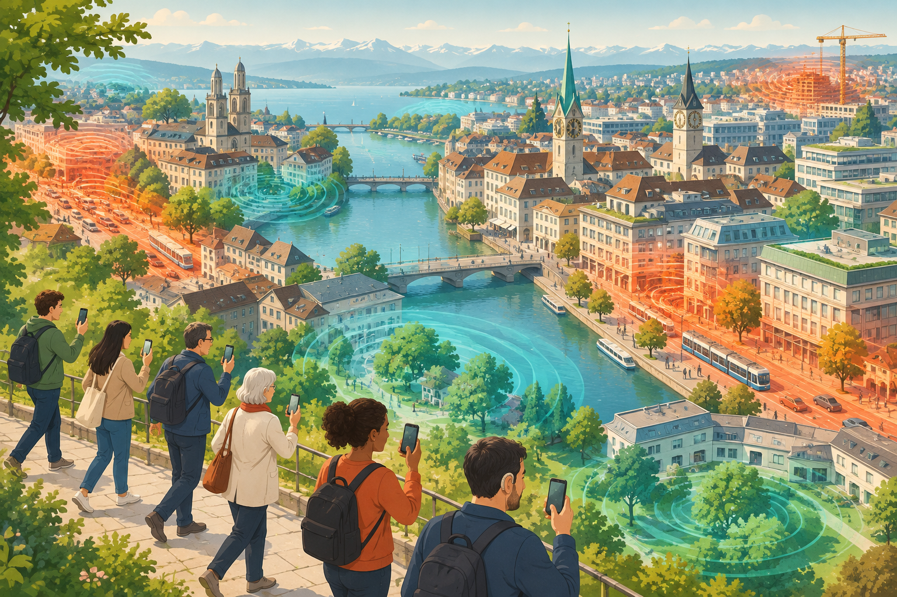

{fig-alt="HearHere participatory noise mapping project"}

HearHere investigates urban sound exposure and subjective sensory experience in Zurich, including people with hearing conditions and neurodivergent sensory profiles. Participants collect georeferenced ambient audio and perceptual ratings using a mobile sensing app. These data support multidimensional mapping of noise hotspots and acoustic relief zones.

A pilot generated over 100 geospatial audio measurements from more than 20 participants. Further data collection and Delphi workshops will inform recommendations for inclusive urban planning.

[Project details and participation](https://www.citizenscience.uzh.ch/en/projects/hearhere.html)
